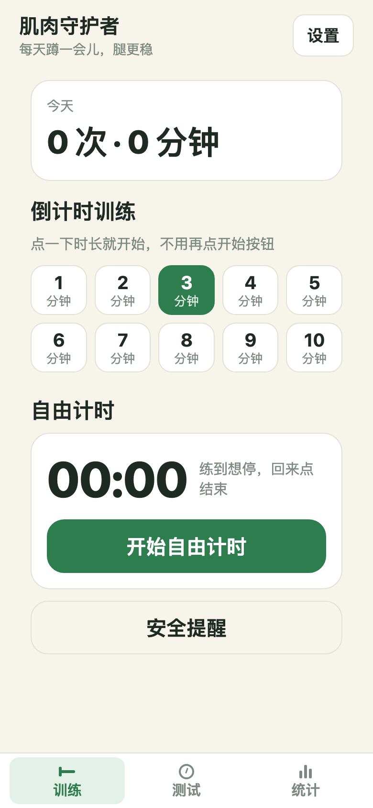
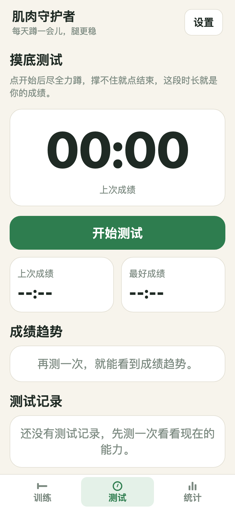
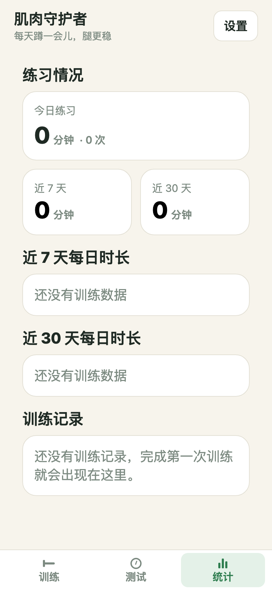

# Muscle Keeper

[简体中文](./README.md) ｜ English

A squat-training companion for the older people in your family: pick a duration, tap once, and it counts down with voice cues and safety reminders. All records stay on the device.

<div align="center">
  
  
  
</div>

> Screenshots come from the real running web build (empty state, no user data). The three bottom tabs are Train / Test / Stats; the settings panel (voice / theme / clear data) opens from the training screen.

## What it is

A simple training companion whose goal is to help older people **squat a little every day and feel steadier on their legs**. No network, no sign-in, no paid courses — open it and use it.

- Who it is for: older family members (especially parents who need leg strength and fall prevention); also anyone who wants a regular squat routine.
- How it is used: pick a duration, start, and follow the voice cues; check the stats afterwards to see progress.

## Core features

- **Countdown training**: 1–10 minute presets start with a single tap (no separate "start" button); pause / resume / stop are supported.
- **Free timer**: train as long as you like and stop when you are done.
- **Voice cues**: start, countdown, time remaining and completion are spoken (falls back to a beep when speech is unavailable locally).
- **Baseline test**: squat as many times as you can, then keep your best score and its trend.
- **Stats charts**: training time for today / last 7 days / last 30 days, shown as a line plus bars.
- **Local and private**: every record stays on the device (AsyncStorage) — no account, no backend, no upload.
- **Safety reminders**: built-in "know your limit" prompts; stop immediately if knees or lower back hurt.

## Quick Start

### For family members (no coding)

- **Android**: download `肌肉守护者.apk` from [Releases](https://github.com/wanghoufan/p064-muscle-guardian/releases) (allow "unknown sources" in system settings before installing).
- **Web / add to home screen**: open <https://wanghoufan.github.io/p064-muscle-guardian/> or <https://p064-muscle-guardian.pages.dev> in a browser, then use the menu entry "add to home screen" to launch it like an app (PWA).

> A release-signed Release is published (see the Releases page) and the APK can be installed directly. The web build is deployed to both GitHub Pages and Cloudflare Pages, and both support adding to the home screen.

### Run it locally

```bash
npm install      # install dependencies
npm start        # start Expo, open on a phone or in the browser
```

## Platforms and support

| Platform | Form | Notes |
|---|---|---|
| Android | APK (package `com.musclekeeper.app`, minSdk 23) | Embedded web build, fully offline, see `android-apk/build.sh` |
| Web | PWA (GitHub Pages / Cloudflare Pages) | GitHub Pages builds and publishes via `.github/workflows/pages.yml` on push to main; Cloudflare uses `npm run deploy:cf` |

Theme supports three states — follow system / light / dark; voice cues can be switched off.

## Data and privacy

- Training records, test records, theme and voice preferences are stored only on the device.
- Clearing can remove training records, test records or everything; clearing does not affect theme or voice settings.
- No server, no accounts, no personal information collected.

## Repository layout (highlights)

```
App.tsx                  entry and global state (three tabs, settings panel)
src/features/train/      training screen (countdown / free timer)
src/features/test/       baseline test screen
src/features/stats/      stats screen (line / bar charts)
src/features/settings/   settings panel (theme / voice / data)
src/services/speech.ts   voice cues (tts with beep fallback)
src/storage/             local persistence (AsyncStorage)
android-apk/             Gradle-free APK packaging path
scripts/                 build / deploy / check scripts
```

## Development

```bash
npm run typecheck   # type check
npm test            # unit tests
npm run lint        # lint
npm run build       # export the static web build to dist/
npm run deploy:cf   # deploy to Cloudflare Pages (needs CLOUDFLARE_API_TOKEN)
```

Android APK packaging: run `npm run build` first, then `bash android-apk/build.sh` (requires Android SDK build-tools locally).

## Safety note

Know your limit; stop immediately if your knees or lower back hurt. Keep the floor dry and non-slip, and keep a chair back within reach. This tool does not replace professional medical advice.

---

Version `0.1.0`. The repository is public — issues are welcome. Built for family use first; the roadmap prioritises stability and ease of use.
