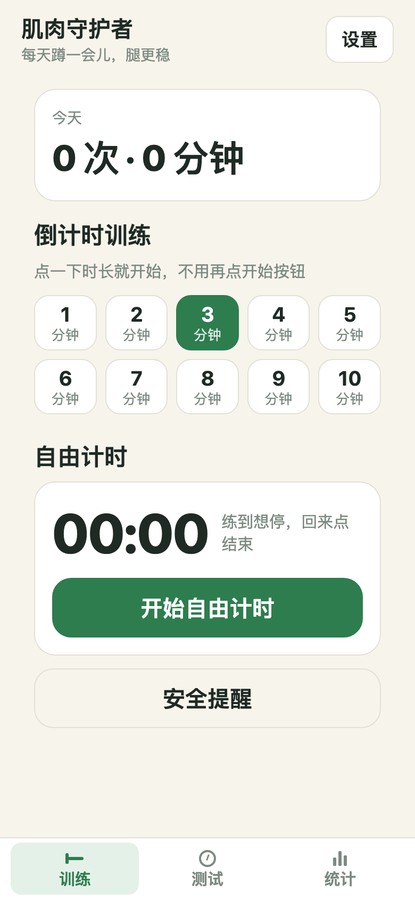
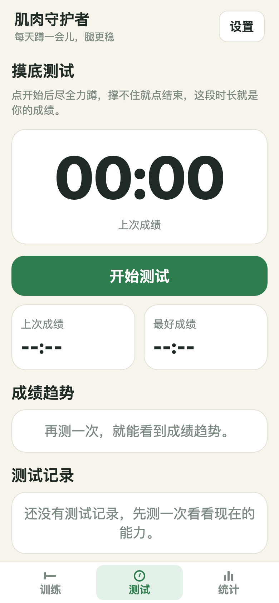
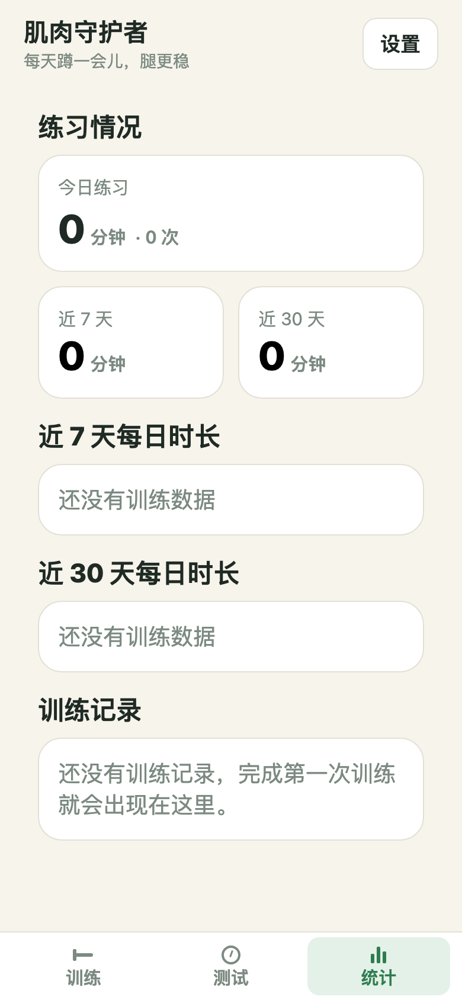
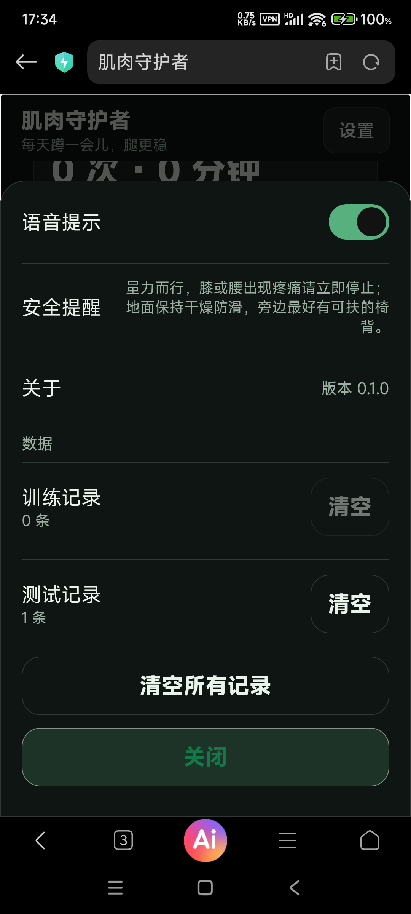

# 肌肉守护者

给家里长辈用的深蹲训练小工具：点一下时长就开始，带语音提示和安全提醒，数据只存在本机。

<div align="center">
  
  
  
  
</div>

> 截图来自真实运行的网页版（空状态，无用户数据）。底部三个 Tab 为「训练 / 测试 / 统计」。

## 这是什么

一个简单的蹲练陪伴工具，目标是让长辈**每天蹲一会儿，腿更稳**。不联网、不登录、不卖课，打开就能用。

- 给谁用：家里长辈（尤其是需要练腿力、防跌倒的父母）；也适合任何想规律做深蹲的人。
- 怎么用：选个时长点一下就开始，跟着语音提示做；做完看统计，慢慢看到进步。

## 核心功能

- **倒计时训练**：1–10 分钟档位一键开始，不用再点「开始」按钮；支持暂停 / 继续 / 结束。
- **自由计时**：练到想停就回来点结束，自己掌握节奏。
- **语音提示**：开始、倒计时、剩余时间、完成都有语音播报（本机不可用时会自动改用提示音）。
- **摸底测试**：尽全力蹲一次，记录最好成绩与成绩趋势，看清自己现在的能力。
- **统计图表**：今日 / 近 7 天 / 近 30 天的训练时长，折线 + 柱状图直观呈现。
- **纯本地、重隐私**：所有记录只存在本机（AsyncStorage），没有账号、没有后端、不上传任何数据。
- **安全提醒**：内置量力而行提示，膝或腰不适请立即停止。

## 快速开始

### 给家人用（不用写代码）

- **安卓**：到 [Releases](https://github.com/wanghoufan/p064-muscle-guardian/releases) 下载 `肌肉守护者.apk`（安装前在系统设置里允许「未知来源」应用）。
- **网页 / 添加到桌面**：用浏览器打开网页版，按菜单「添加到桌面」即可像 App 一样从桌面启动（PWA）。

> 已发布 **release 签名**的正式 Release（见 Releases 页），APK 可直接安装分发；网页版部署在 Cloudflare Pages，同样可添加到桌面。

### 自己跑起来改

```bash
npm install      # 安装依赖
npm start        # 启动 Expo，手机或浏览器打开
```

## 平台与支持

| 平台 | 形态 | 说明 |
|---|---|---|
| Android | APK（包名 `com.musclekeeper.app`，minSdk 23） | 内嵌网页、完全离线，见 `android-apk/build.sh` |
| Web | PWA（Cloudflare Pages） | `npm run build` 后 `npm run deploy:cf` 部署 |

主题支持「跟随系统 / 浅色 / 深色」三态；语音提示可开关。

## 数据与隐私

- 训练记录、测试记录、主题与语音偏好都只保存在设备本地。
- 清空功能可分别清空训练记录、测试记录或全部记录；清空不影响主题、语音等设置。
- 没有服务器、没有账号体系、不收集任何个人信息。

## 目录结构（要点）

```
App.tsx                  入口与全局状态（三个 Tab 切换、设置面板）
src/features/train/      训练页（倒计时 / 自由计时）
src/features/test/       摸底测试页
src/features/stats/      统计页（折线 / 柱状图）
src/features/settings/   设置面板（主题 / 语音 / 数据）
src/services/speech.ts   语音提示（tts + 提示音兜底）
src/storage/             本地持久化（AsyncStorage）
android-apk/             免 Gradle 的 APK 打包通道
scripts/                 构建 / 部署 / 校验脚本
```

## 开发

```bash
npm run typecheck   # 类型检查
npm test            # 单元测试
npm run lint        # 代码检查
npm run build       # 导出 Web 静态产物到 dist/
npm run deploy:cf   # 部署到 Cloudflare Pages（需 CLOUDFLARE_API_TOKEN）
```

安卓 APK 打包：先 `npm run build`，再 `bash android-apk/build.sh`（需本机 Android SDK build-tools）。

## 安全提示

量力而行，膝或腰出现疼痛请立即停止；地面保持干燥防滑，旁边最好有可扶的椅背。本工具不替代专业医疗建议。

---

版本 `0.1.0`。仓库为公开项目，欢迎提 Issue；本项目以家庭自用为起点，路线图以稳定易用为主。
